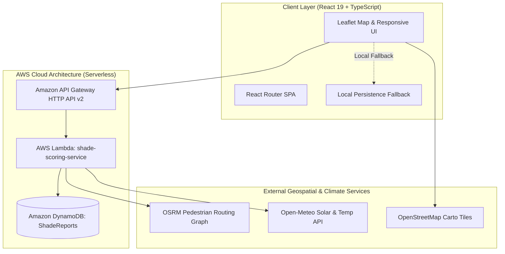

# ShadeRoute — Find the Cooler Way

> **Environmental Hacks 2026 | Bharat Builds Tour**  
> *"The shortest way isn't always the coolest way."*

Pedestrian heat-risk and shade-aware walking navigation. ShadeRoute helps pedestrians, delivery workers, students, and elders compare walking paths in hot urban weather based on tree canopy coverage, ambient heat exposure, solar geometry, and public cooling amenities.

## 1. Problem & Solution

Traditional navigation applications optimize walking routes purely for Euclidean distance or speed. During extreme Indian heatwaves (temperatures exceeding 42°C / 107°F), this routing logic frequently directs pedestrians onto unshaded, multi-lane asphalt boulevards where pavement surfaces heat up to 60°C. 

**ShadeRoute** introduces a shade-aware routing paradigm:
- Analyzes pedestrian street networks via **OSRM (Open Source Routing Machine)**.
- Integrates **tree canopy inventories and covered arcade data**.
- Calculates diurnal solar zenith angles to evaluate direct sun exposure versus shade protection.
- Incorporates crowdsourced community cooling assets: free municipal RO drinking fountains, shaded resting benches, and broken shade alerts.
- Computes a transparent **0–100 Estimated Exposure Score** with honest missing-data handling.

## 2. Architecture & AWS Integration

### Architecture Diagram (Mermaid)



### AWS Serverless Components
1. **Amazon API Gateway (HTTP API v2)**: Low latency, auto-scaling REST entry point (`GET /health`, `POST /routes/compare`, `GET /reports`, `POST /reports`).
2. **AWS Lambda (Node.js 22 LTS / ARM64)**: Stateless route aggregation, solar angle calculation, and DynamoDB document client handling.
3. **Amazon DynamoDB**: `ShadeReports` table with Single-Table design and GSI (`CategoryIndex`) for fast category queries.
4. **Local Fallback Parity**: When AWS credentials are not configured, the local Express server (`server.ts`) and client-side engine run with full feature parity.

## 3. Signature Features

### 1. ShadeScore™ Route Intelligence Engine
- Transparent route-level estimated heat-exposure calculation on a 0–100 scale.
- Displays shade-data coverage %, distance, walking time, data confidence, and clear reasons behind every recommendation.
- **Honest Missing-Data Standard**: Suppresses fabricated numbers when tree survey coverage drops below 25%, displaying *"Shade data unavailable"*.

### 2. Shade Gap Detector (`/explorer`)
- Street-level visualization of pedestrian walking corridors:
  - **Well-Shaded Segments**: verified canopy corridors (e.g. Janpath Boulevard).
  - **Low-Shade Segments**: sparse sapling or reflective glass sectors.
  - **Severe Shade Gaps**: wide exposed roadways with high heat exposure (e.g. Connaught Circus Outer Circle).
  - **Unknown-Data Segments**: unsurveyed streets requiring crowd verification.
- Supports community voting for municipal native tree planting targets (Neem, Peepal, Rain Tree).

### 3. ShadeSpot Community (`/community`)
- Crowdsource shaded walkways, tree canopy, shaded resting benches, free municipal RO water dispensers, and broken shade warnings.
- **Duplicate-Report Detection**: Prevents duplicate entries within 45m of existing amenities while allowing users to confirm/upvote existing points.

### 4. TimeShift — Best Time to Walk (`/timeshift`)
- Predictive departure window optimizer comparing conditions between 07:00 and 19:00.
- Integrates hourly solar irradiance (W/m²), UV index, and temperature from **Open-Meteo**.
- Generates actionable advice (e.g., *"Walking at 17:00 instead of 13:00 cuts estimated heat exposure by 46%"*).

### 5. Comfort Mode Personalization
- Users can switch routing preferences:
  - **Balanced Cooler Route**: standard trade-off (+2-3 min for ~52% less sun).
  - **Maximum Shade**: scenic detour through deep botanical canopy.
  - **Fastest Arrival**: direct Euclidean path with transparent heat penalty warnings.
  - **Verified Rest & Water**: prioritizes accessible paths with drinking water kiosks.

### 6. Urban Heat Action Dashboard (`/dashboard`)
- Aggregates community reports by locality (Central Delhi, Bengaluru, Mumbai South, Ahmedabad).
- Tracks pedestrian shade gaps, tree-planting target priorities, and data freshness metrics.

### 7. ShadeRoute Live Decision Card
- Visual comparison card directly presenting:
  - **Fastest Route** (e.g., 12 min, less walking time) vs. **Shade-Preferred** (e.g., 15 min, more mapped shade).
  - Immediate clarity on trade-offs and recommendation reasons.

## 4. Application Pages & Navigation

| Route | Page | Purpose |
| :--- | :--- | :--- |
| `/` | **Home** | Problem/solution, quick route trigger, and interactive preview |
| `/planner` | **Route Planner** | Interactive Leaflet map, ShadeScore™, Comfort Mode, Live Decision Card |
| `/explorer` | **Shade Explorer** | Shade Gap Detector, street-level gap spectrum, tree-planting voting |
| `/timeshift` | **TimeShift** | Departure hour optimizer with hourly solar & UV curves |
| `/community` | **Community Shade** | Crowdsource shade & water spots with duplicate detection |
| `/dashboard` | **Impact Dashboard** | Urban Heat Action Dashboard for planners & citizens |
| `/methodology` | **About & Data** | Mathematical formulation, weight simulator, and AWS architecture |

## 4. Getting Started

### Local Development

1. **Clone the repository**:
   ```bash
   git clone https://github.com/your-username/shaderoute.git
   cd shaderoute
   ```

2. **Install dependencies**:
   ```bash
   npm install
   ```

3. **Run automated unit tests**:
   ```bash
   npm test
   ```

4. **Start the local full-stack development server**:
   ```bash
   npm run dev
   ```
   Open [http://localhost:3000](http://localhost:3000) in your browser.

## 5. Testing

Unit tests for the scoring engine, diurnal solar intensity curve, missing data handling, and custom weights are located in `src/utils/scoringEngine.test.ts`.

Run tests with:
```bash
npm test
```

## 6. Known Limitations & Disclaimers

- **Non-medical estimate**: ShadeRoute provides relative algorithmic estimates. It does not measure human internal core temperature or physiological heat illness susceptibility.
- **Microclimate variations**: Local wind, humidity, and building surface reflectivity may create microclimatic variations.
- **Tree Canopy Data Density**: Indian urban tree inventories vary across municipal corporations. ShadeRoute highlights data confidence tiers honestly.

## 7. License

Open source under Apache-2.0 License. Developed for Environmental Hacks 2026 | Bharat Builds Tour.
